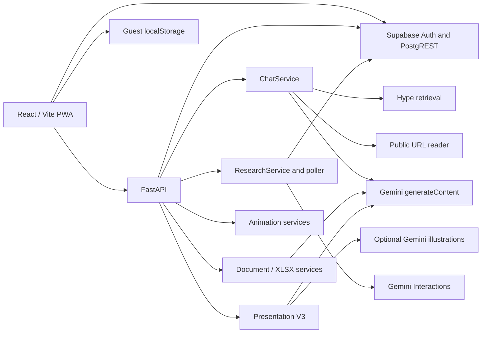

# Current architecture

Baseline `7f5edc6`. The uncommitted grounding patch adds provider diagnostics and a local probe. It does not change routing or evidence rules. Production hosting references below describe the supplied topology and repository configuration.

| Component | Executable behavior and references |
|---|---|
| Browser | `PromptComposer` chooses actions and validates attachments. `AskHypeShell` owns active thread, optimistic state and route selection. `ConversationThread` renders full replies, cards, evidence and specialty results. Ordinary chat awaits JSON and shows a loading indicator. Deep Research polling and completed-file delivery are distinct mechanisms. [Composer](../../../src/components/askhype/PromptComposer.tsx#L24) · [Shell](../../../src/components/askhype/AskHypeShell.tsx#L131) · [Chat HTTP](../../../src/services/chat-api.ts#L226) · [Thread](../../../src/components/askhype/ConversationThread.tsx#L246) |
| API and auth | FastAPI mounts routes with the configured API prefix and explicit CORS origins. Request identity verifies Supabase JWT claims, reads the server-controlled profile, or uses a server-HMAC guest UUID. The browser uses Supabase Auth directly. Specialized research/animation routes use authenticated identity where required. [Entrypoint](../../../backend/app/main.py#L22) · [Identity](../../../backend/app/auth/identity.py#L42) · [JWT verifier](../../../backend/app/clients/supabase.py#L42) · [Dependencies](../../../backend/app/api/dependencies.py#L76) |
| Quota | Chat reserves before dispatch, finalizes completed or mapped failure, and exposes usage headers. All plans currently use a rolling 24-hour window with plan-specific limits. PostgreSQL reserve/finalize RPCs enforce limits when configured; local mode uses in-memory storage. User allowance and provider spending are separate concerns. [Chat route](../../../backend/app/api/routes/chat.py#L28) · [Usage service](../../../backend/app/services/usage_service.py#L50) · [Quota SQL](../../../supabase/migrations/202609190001_hype_ask_002_rolling_quotas.sql) |
| Providers | `AIProvider` collects chat, document, XLSX and presentation planning operations. `ChatService` selects mock or Gemini directly. Other providers implement separate research and animation protocols. Existing Pydantic outputs, document safety, deadline and normalized exception patterns are reusable. There is no cross-vendor gateway, token stream or central capability registry. [Protocol](../../../backend/app/providers/base.py#L12) · [Gemini](../../../backend/app/providers/gemini.py#L459) · [Mock](../../../backend/app/providers/mock.py) · [Config](../../../backend/app/core/config.py#L14) |
| Persistence | Guest browser storage and direct authenticated PostgREST use one UI model. Conversation rows, messages and ownership policies live in Supabase. FastAPI owns research jobs, usage and profiles. Standard ChatService has no transcript repository. [Repository](../../../src/services/conversation-repository.ts#L65) · [History SQL](../../../supabase/migrations/202611220001_ask_p0_history_conversations.sql) |
| Deployment | React deploys as static Vite output. `VITE_API_BASE_URL` controls the FastAPI destination, with localhost default. Vercel’s catch-all is an SPA rewrite. It does not specify an API backend. The Dockerfile runs Uvicorn as non-root and supplies a health check. The hosting names and shared DB are operational claims from the brief. Inspect deployment dashboards and actual requests before asserting route parity. [API base](../../../src/constants/api.ts) · [Vercel](../../../vercel.json) · [Docker](../../../backend/Dockerfile) · [PWA](../../../vite.config.ts#L48) |
| Tests and deployment checks | CI runs frontend lint, type/build and backend pytest. Frontend Vitest exists but is absent from this CI workflow. No live model or browser-account quality gate is encoded here. [CI](../../../.github/workflows/ci.yml) · [Scripts](../../../package.json) |

## Capability boundaries

| Capability | Current path and lifecycle | V2 boundary |
|---|---|---|
| Hype content | `ChatService.generate_response` recognizes Hype, fetches allowlisted official sources via `HypeRetriever.retrieve`, and builds constrained cited cards. Event logic uses explicit dates, location and conflict checks. | Keep an internal read-only domain tool with explicit grounding and data-as-data semantics. Avoid making every mention of a brand route the entire conversation. [Retrieval](../../../backend/app/services/hype_retrieval.py#L348) · [Hype response](../../../backend/app/services/hype_response.py) |
| Public URLs | `PublicSourceReader.retrieve` fetches and extracts explicitly linked public documents before ordinary grounding. | Reuse as bounded tool with current SSRF protections, citation provenance and prompt-injection boundary. Never allow a model to fetch arbitrary private destinations. [Reader](../../../backend/app/services/public_sources.py#L154) |
| Images, documents and XLSX | Image upload joins ordinary chat as multipart. Document and XLSX actions use separate endpoints, extract bounded content and use a Gemini answer or typed transformation, respectively. | Reuse vetted extraction and strict transformation contract. Treat bytes and extracted text as private content. Pass attachments across providers only when authorized and supported. [Routes](../../../backend/app/api/routes/documents.py#L34) · [Extraction](../../../backend/app/services/document_extraction.py#L64) |
| Presentation V3 and illustrations | `/api/presentations/generate` produces a typed plan, validates evidence, renders editable native PPTX, and optionally adds bounded image assets after native validation. Frontend receives a Blob and renders download UI. | Keep separate planner, illustration and render interfaces. Preserve native fallback, quotas, file contract and offline replay. [Presentation route](../../../backend/app/api/routes/presentations.py#L22) · [Service](../../../backend/app/services/presentation_generation.py#L57) · [Illustrations](../../../backend/app/services/presentation_illustrations.py) |
| Deep Research | Authenticated POST returns a durable job. Browser polling and background reconcile update status using the Gemini Interactions provider. A completion trigger saves linked assistant results. | Keep separate asynchronous lifecycle and quota. Reuse canonical message/citation references after isolation and idempotency review. [Routes](../../../backend/app/api/routes/research.py#L20) · [Provider](../../../backend/app/providers/research.py#L56) |
| Animation and future tools | Feature-flagged endpoints create safe deterministic SVG storyboards from art direction, plus separate controlled animation paths. Future general image generation has no ordinary chat execution path here. | Register typed tools/services with per-capability permission and cost controls. Preserve SVG validation and UI isolation. [Animation routes](../../../backend/app/api/routes/animations.py#L34) · [Generation](../../../backend/app/services/generative_svg_generation.py) |

## Documentation and implementation gaps

- The backend README describes staging with explicit credentials and a staging project. The supplied shared-project topology needs verification and an isolation decision. [Environment guidance](../../../backend/README.md#L363)
- Deployment notes about downloadable-file history reflect real behavior. Browser-owned Blob URLs are downgraded on persistence. This should be distinguished from a missing conversation. [Storage sanitizer](../../../src/utils/conversation-storage.ts#L41) · [README](../../../backend/README.md#L587)
- “Tool supplied,” a successful HTTP response and relevant citations are three different outcomes. Release tests prove the API contract with fixtures and do not establish the latter under live prompts. [Grounding fixtures](../../../backend/tests/test_chat_grounding.py) · [Probe](../../../backend/scripts/gemini_grounding_probe.py)
