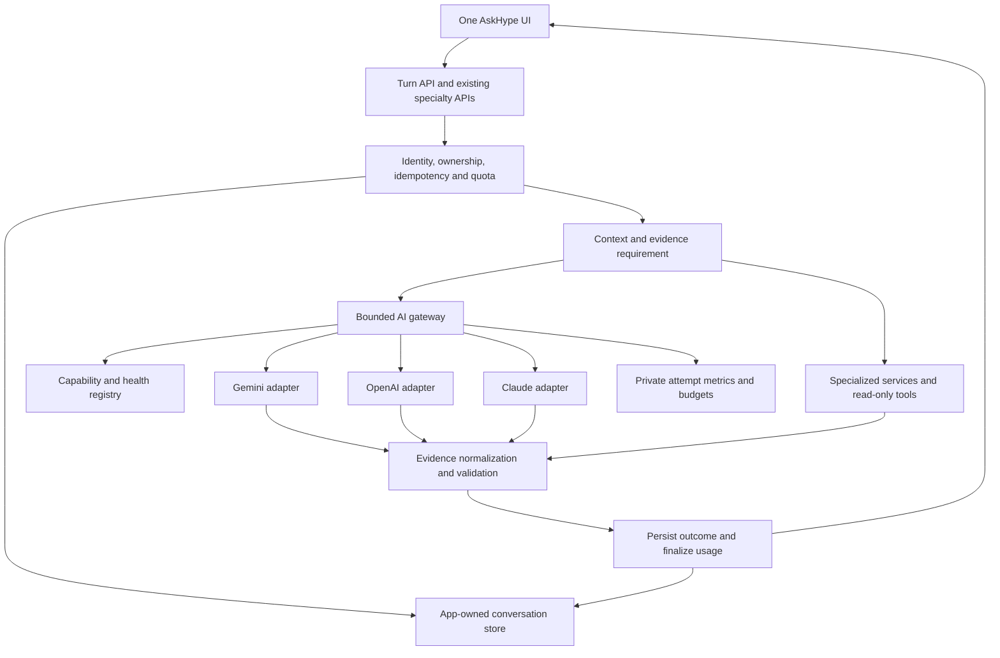

# Proposed AskHype AI Core V2



## Component responsibilities

| Owner | Responsibility |
|---|---|
| UI | Present one assistant identity. Submit immutable turn ID, latest intent and attachments; render status, text and citations; recover by turn ID. Keep dedicated artifact and research actions. |
| Turn application service | Own the principal, conversation membership, execution lifecycle, deduplication and usage settlement. Validate attachment ownership and create a bounded context snapshot. |
| Context policy | Preserve explicit current intent and language, select recent relevant context, mark untrusted materials and evidence requirements. Clarify ambiguity when needed. |
| Gateway | Enforce deadline, cost and attempt budget against the configured capability, credential and health matrix. Preserve intent during eligible fallback. |
| Adapter | Translate canonical messages and capabilities to native provider calls. Normalize finish, errors, evidence, usage and events. Preserve useful provider-specific metadata internally. |
| Evidence and tool services | Attribute sources, enforce freshness/claim relevance and permissions, and bound native/local tool work. Existing specialized services own their domain semantics. |
| Conversation and ops stores | Durable turns, artifact references, audit-safe metrics and lifecycle events. Keep provider credentials and raw content out of attempt telemetry. |

## Canonical application data

- Conversation has owned UUID, scope, version, server timestamps, optional title and explicit preferences. Guest storage may project the same model locally.
- Turn has stable client idempotency key scoped by environment, principal and conversation; user message ID, optional assistant message ID, intent and phase (`accepted/running/completed/failed/interrupted`), and context snapshot version. Reusing a key with different input yields a conflict.
- Message has stable UUID, server sequence, role, created time, content parts and reply-to/turn links. Parts support text, authorized attachment/document references, evidence-bound tool results and artifact or research references. Provider session IDs are optional adapter bookkeeping.
- Evidence records a stable source ID, provider/tool or document provenance, safe URL or owned document locator, display label, observed time and citation spans. Optional retrieved metadata stays separate from answer text. Persist enough to render citations after provider switching.
- Execution attempt records selected provider, model, adapter version, result category, latency, optional usage and estimates, deadline and billing project alias. Keep this private and independent of the transcript.

Context uses the latest user message verbatim, a token-budgeted recent sequence with role separation, and relevant prior answer/evidence for follow-ups. Pin explicit preferences only with user intent and scope. Exclude unrelated topics and stale evidence where possible. Quote retrieved and uploaded text as data. If a prior turn or artifact cannot be recovered, clarify. Add durable summaries only after measuring truncation failures; any summary is lossy, versioned and never the source of current evidence by itself.

## Proposed interface

```python
class ChatAdapter(Protocol):
    def capabilities(self) -> CapabilityManifest: ...
    async def generate(self, request: ProviderTurn, budget: AttemptBudget) -> ProviderResult: ...
    def stream(self, request: ProviderTurn, budget: AttemptBudget) -> AsyncIterator[ProviderEvent]: ...
```

`ProviderTurn` carries role-typed messages, focused system policy, requested modalities/tools and optional schema ID. `AttemptBudget` carries absolute deadline and limits for tokens, tools and estimated cost. `ProviderResult` carries answer parts, normalized evidence, termination status and optional usage. `ProviderEvent` covers deltas, evidence, finish and interrupt. Availability/circuit state is maintained by the gateway from real outcomes and configured operational signals. Specialized provider interfaces continue to own agent jobs, illustration and schema-specific planners.

## Execution and fallback

1. Authenticate, resolve owned conversation, validate input/attachments and look up the stable turn key. Persist acceptance and reserve one user quota independently of attempt count.
2. Resolve specialized mode or classify the evidence requirement with latest-message priority and relevant history. Build bounded context and choose an eligible provider. Explicit required evidence survives adapter switching.
3. Use one primary attempt and at most one ordered, sequential fallback attempt per turn in P0. Fallback consumes the remaining shared wall-clock and cost budgets. No fan-out; no implicit second formatting call. Start with non-streaming until durable settlement and browser recovery are tested. Configure each underlying SDK to respect the attempt cap.
4. Use provider-native tools when eligible, normalize citations and validate evidence before committing a current factual answer. Failed evidence yields a clear limitation unless one eligible fallback is explicitly allowed by policy and budget.
5. Save the assistant result and reconcile quota exactly once from the application's perspective. Track transport loss after dispatch as an uncertain provider outcome. Use provider idempotency where available; otherwise avoid automatic redispatch of unknown in-flight work. Return/recover the same turn status on replays.
6. For streaming later, permit fallback before the first user-visible output only. Track partial text as interrupted, never stitch a different provider onto visible partial text, and require an explicit retry from the same conversation. Buffer evidence-required final content or label provisional data so unvalidated claims do not appear as verified.

| Outcome | Gateway policy |
|---|---|
| Invalid input, auth/ownership, user quota | Stop before calling a provider. |
| Provider credit exhausted or disabled credential | Open a project-scoped circuit, alert and use one eligible approved fallback before output. Never retry identical billing failure. |
| Provider rate limit, availability, transport or timeout | Respect Retry-After and deadline. Prefer one eligible fallback when dispatch status is safe and budget remains. Unknown execution state requires reconciliation. |
| Unsupported model/tool combination | Reject during capability selection or record a capability mismatch and try one verified eligible adapter. |
| Missing/irrelevant evidence | Separate evidence outcome; allow only approved evidence-capable fallback. Otherwise state the limitation. |
| Safety refusal, disallowed tool or data-transfer policy | Stop, with no fallback to evade policy or consent. |
| Internal error, schema/normalization defect | Safe failure and alert. No automatic mask by provider switching. |

Use project/capability-scoped circuits for billing, transient pressure and repeated provider errors, with bounded cooldown and controlled recovery. Reserve spend against global daily and per-request ceilings before dispatch. Release estimate and reconcile actual tool usage where known. Shared caps need durable atomic accounting to be enforceable across instances. Fallback must respect consent and retention policy for the second provider, particularly for private attachments.
