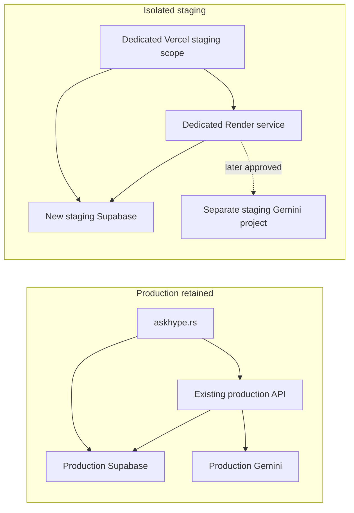

# ASK-ENV-001A · Environment isolation

**Decision:** Prepare a dedicated staging Supabase project before hosting the ASK-CORE-008B candidate or applying its migration to any shared database. This is an execution plan only. No credentials, project settings, hosted endpoints, or deployed versions were inspected through platform accounts.

- [Configuration and bootstrap](01-configuration-and-bootstrap.md)
- [Cutover, UAT and production rollback](02-cutover-and-release.md)

## Current and target topology

| Boundary | Current evidence | Proposed staging | Production target |
|---|---|---|---|
| Frontend | Production `https://askhype.rs` at reported release `7f5edc6`. Prior investigation identified `https://askhype.vercel.app` as staging. Vercel project and deployment alias mapping are unverified. | A dedicated Vercel staging project or demonstrably isolated deployment scope with one canonical HTTPS origin, synthetic accounts and controlled access. Reuse the staging host only after proving that it cannot repoint the production domain. | Keep production domains, deployment and settings untouched during staging cutover. |
| Backend | Prior staging URL `https://askhype.onrender.com`. Exact production API routing, current Vite API base, Render service mapping and worker count are unverified. The repo's Vercel rewrite serves the SPA and defines no API proxy. | One dedicated Render web-service instance with a staging-only environment group and network bindings. Health check `/api/health`. Avoid using a service also reached by production. | Preserve existing API routing and production release until separately approved. |
| Database and Auth | The brief reports historical sharing of one Supabase project. No live project ref, bindings or migration ledger were inspected. | New Supabase project, separate project ref, JWT issuer, public key, server key and generated guest pepper. Synthetic identities and fixtures only. | Keep existing project, auth accounts, credentials and data in place. |
| AI and email | Gemini is the runtime AI integration, with a mock provider for supported local/staging paths. Supabase Auth owns email dispatch. Current project/billing/SMTP assignments are unverified. | Start with mock AI, no Gemini key or agent. If separately approved, use dedicated staging Gemini project credentials/budget and restricted staging SMTP delivery. | No changes here. Production and staging secrets must remain distinct. |

Frontend traffic destinations are determined by the build-time API and Supabase values. Confirm the actual hosting/project mapping before touching a DNS alias, deployment or service. A domain name alone does not establish environment ownership. [Frontend API base](../../../src/constants/api.ts) · [Browser Supabase client](../../../src/utils/supabase.ts) · [Vercel rewrites](../../../vercel.json) · [Docker runtime](../../../backend/Dockerfile)

## Supabase dependency map

| Area | Actual dependency and boundary |
|---|---|
| Auth and identity | Supabase Auth provides signup, password login, session/refresh/logout and recovery email. FastAPI verifies bearer JWT claims through Supabase and resolves the profile/plan. Guest requests use a server-HMAC anonymous ID. The issuer, signed tokens, and keys must all belong to staging for staging tests. [Auth context](../../../src/auth/AuthContext.tsx) · [Auth verifier](../../../backend/app/clients/supabase.py) · [Request identity](../../../backend/app/auth/identity.py) |
| Roles and profiles | Managed `auth.users`, `auth.uid()`, `anon`, `authenticated`, and `service_role`. The profile trigger creates a free row on signup. Owner RLS allows own reads and updates of preference columns. Plan and mock-premium eligibility are privileged fields. [Base migration](../../../supabase/migrations/202609190001_hype_ask_002_rolling_quotas.sql) |
| Ordinary quotas and animation | `usage_events` and `animation_usage_events` hold reservations/finalization. Privileged calls use `reserve_prompt_usage`, `finalize_prompt_usage`, `reserve_animation_usage`, and `finalize_animation_usage`. Browser accounts cannot write these ledgers. Prompt quotas include chat, document and presentation routes. [Usage repository](../../../backend/app/repositories/usage_repository.py) · [Animation quota migration](../../../supabase/migrations/202611130002_ask_anim_001_animation_quota.sql) |
| History | `conversations` and `conversation_messages` are owner-scoped via RLS and an ownership FK. Guests keep local history. ASK-CORE-008B adds paged account reads and RPC-only `chat_turns` and `deleted_chat_turns`. Service-role RPCs `accept_chat_turn`, `settle_chat_turn` and `read_chat_turn` coordinate durable admission, lookup and quota settlement. Restrictive message policies protect server-authored ordinary rows. [History migration](../../../supabase/migrations/202611220001_ask_p0_history_conversations.sql) · [Turn migration](../../../supabase/migrations/202611260001_ask_core_008b_chat_turns.sql) |
| Deep Research | `research_jobs` and `reserve_research_job` are backend-owned. The linked completion trigger `persist_research_conversation_result` writes the owned assistant message in PostgreSQL. Provider job IDs point to the Gemini project used for creation. Neither the jobs nor the related provider sessions are portable fixture data. [Research migration](../../../supabase/migrations/202611130001_ask_dr_001_research_jobs.sql) · [Lifecycle migration](../../../supabase/migrations/202611250001_research_conversation_lifecycle.sql) |
| Storage | No application bucket configuration, `storage.objects` policies, or bucket API use was found in the reviewed app paths or six migrations. Attachments use multipart and bounded processing. PPTX and XLSX are returned as downloads, with browser object URLs. The isolated project can leave Storage empty. [Document routes](../../../backend/app/api/routes/documents.py) · [Presentation route](../../../backend/app/api/routes/presentations.py) · [Browser response handling](../../../src/components/askhype/AskHypeShell.tsx) |

## Other dependencies

- Gemini Developer API supplies chat, native Google Search grounding, document/XLSX and presentation planning, optional illustration generation, and animation art direction. Deep Research uses Gemini Interactions separately. Grounding is selected in application code, with no dedicated grounding environment flag. Hype retrieval uses public allowlisted Hype sites. Explicit URLs use the existing bounded public reader. No OpenAI or Anthropic runtime configuration is required. [Gemini provider](../../../backend/app/providers/gemini.py) · [Research provider](../../../backend/app/providers/research.py) · [Hype retrieval](../../../backend/app/services/hype_retrieval.py) · [Public URL reader](../../../backend/app/services/public_sources.py)
- Node/Vite ships static assets and Workbox. FastAPI can use the existing non-root Python 3.12 Dockerfile. Legacy private runtime-cache cleanup belongs in the staging candidate and rollback artifact. LibreOffice is local QA only. The optional MP4 PoC has tooling requirements and stays off. [PWA config](../../../vite.config.ts) · [Cache upgrade](../../../public/history-cache-upgrade.js) · [Backend README](../../../backend/README.md)
